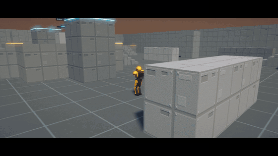

# Kinetic Arena

[](https://hits.sh/github.com/knapply/arena-shooter-experiment/)

A fast, movement-focused arena shooter that runs entirely in the browser. Thrust, slide, clamber, hover and ground-pound through a symmetric arena, fight practice drones solo, or play 4v4 Capture the Flag with friends over a direct peer-to-peer connection. No install, no accounts, no downloads.

**▶ Play:** https://knapply.github.io/arena-shooter-experiment/

[](https://knapply.github.io/arena-shooter-experiment/media/trailer.mp4)

**🔊 [Watch the full trailer with sound](https://knapply.github.io/arena-shooter-experiment/media/trailer.mp4)** · captured straight from the game, with an original soundtrack synthesized in the browser. Or press **Watch trailer** in the game menu to play it live.

---

## Contents
- [Features](#features)
- [Game modes](#game-modes)
- [Playing with friends](#playing-with-friends)
  - [Relay servers for strict networks](#relay-servers-for-strict-networks)
- [Controls](#controls)
- [Weapons and combat rules](#weapons-and-combat-rules)
- [Movement](#movement)
- [The AI](#the-ai)
- [Settings](#settings)
- [Tech overview](#tech-overview)
- [Browser support and performance](#browser-support-and-performance)
- [Privacy and security](#privacy-and-security)
- [Known limitations](#known-limitations)
- [Development](#development)
- [Roadmap](#roadmap)
- [License](#license)

---

## Features
- **Full movement kit:** sprint, slide, thruster dash, ledge clamber, crouch-jump, aerial stabilize, aimed ground pound and shoulder charge, with consistent timing you can learn
- **Shields and health:** recharging shields that flash on impact, with headshot rules that reward finishing cracked opponents
- **Three weapons with fixed kill times:** a precision magnum (5-shot perfect kill in about a second), an automatic pulse carbine, and a sniper rifle power weapon. Precision weapons have no random spread
- **Grenades:** bouncing frags and sticky plasmas
- **Destructible cover:** dozens of breakable crates, barricades and walls on both maps, tunable or fully disabled, rebuilding over time
- **Free-for-all matches:** first to 15 kills, with practice drones when it's quiet
- **Capture the Flag:** 4v4 on a mirrored map, with AI filling every empty slot
- **Kill cam:** after you die, see the last few seconds through your killer's eyes
- **Play of the Game:** every match ends with a cinematic replay of its best moment (multikills, sprees, clutch captures)
- **Match intros:** a five-second flyover of the map, both teams at their spawns, the objective and the power weapon
- **Motion tracker:** a 25 m radar showing enemies who run, jump or shoot (crouch-walking keeps you off it)
- **Pings:** mark an enemy, weapon or place for your team; AI teammates respond to them
- **Medals:** multikills, sprees, Perfect (a minimum-shot kill with no misses), headshots, revenge and more, with announcer callouts
- **AI that learns:** bot teams adapt strategy, lane choice and fighting style across matches, and talk to each other in team comms
- **AI vs AI spectating:** a director camera that cuts to the big moments in slow motion, a free tactical camera, a live intel panel and background training
- **Online play:** peer-to-peer rooms with a 5-character code or invite link, up to 8 players, with direct player-to-player links, smooth remote movement under real-world lag, and host migration
- **Controller support:** Xbox-style controllers with remapping, aim assist, response curves and vibration
- **Deep settings:** graphics presets plus 50+ individual options, full keyboard and controller rebinding, and export/import of settings as a file
- **Cinematic trailer:** a one-minute in-engine trailer with letterboxed cinematography, slow motion and an original choir-and-synthwave score, playable from the menu
- **Animation:** procedural characters with distance-synced strides, hip-led strafing and backpedaling, feet that plant on stairs and ledges, spring-driven lean, landing compression, hit flinches, recoil and momentum-based death falls
- **Movement tutorial:** a narrated, self-playing walkthrough of every movement and combat mechanic
- **Procedural audio and announcer:** synthesized weapon and movement sounds, with spoken callouts using your browser's speech engine

## Game modes

| Mode | Players | Description |
|---|---|---|
| **Arena** | 1–8 | Free-for-all on Proving Grounds. First to 15 kills (or the most kills after 10 minutes) wins, then Play of the Game and a fresh match. Practice drones fill in when it's quiet. |
| **Capture the Flag** | 1–8 humans, 8 total | 4v4 on Twin Foundry. Bring the enemy flag to your stand while yours is home. First to 3 captures wins, with an 8-minute time limit. Humans take a bot's slot on their team. |
| **AI vs AI** | Spectator | Two learning AI teams play CTF. Speed controls (1×/2×/4×), a director camera that varies its shots and slows down for captures and multikills, follow cameras, and a tactical camera you can turn and zoom (drag, wheel, pinch or controller). The intel panel shows each team's strategy odds and evolved play style. "Train 10 matches" runs headless matches in the background. |
| **Trailer** | Spectator | A one-minute cinematic cut of the game with an original score, synced to the music. |
| **Movement tutorial** | Spectator | A scripted walkthrough of every movement and combat mechanic, with the keys for each. |

## Playing with friends
1. Open the game and click **Host a room**. You'll get a 5-character code.
2. Click **Copy invite** and send the link, or just send the code.
3. Friends open the link (it joins automatically) or enter the code and click **Join**.
4. Deploy into the Arena together, or have one person start **Play CTF** while everyone else picks a team and clicks **Join match**.

Notes:
- **Every player connects directly to every other player** for movement, so what you see of a friend doesn't detour through the host. The host relays the rest (names, scores, hits, flags).
- **If the host leaves, the room carries on.** The host keeps a backup (the player with the best connection); everyone moves to the backup automatically, and it takes over the room code so friends can still join. A CTF match in progress is taken over by a player in it, with the score and clock intact.
- **The host sees a "Hand host to …" button** when another player would make a better host (lower worst-case ping to everyone), and can hand the room over in one click.
- In CTF, the host runs the AI, flags and score for everyone.
- Switch teams any time with **J**, **D-pad up**, or the pause menu.
- Everyone needs an internet connection. Very strict networks (some workplaces, some mobile carriers) can block direct connections; see [relay servers](#relay-servers-for-strict-networks).

### Relay servers for strict networks
If players can't connect directly, a relay (TURN) server fixes it. Add your relay's details to the page address before hosting or joining, for example:

```
https://knapply.github.io/arena-shooter-experiment/?turn=turns:USER:PASSWORD@relay.example.com:443
```

Several can be listed with commas. Any standard TURN service works (self-hosted coturn or a hosted provider). Everyone in the room should use the same address.

## Controls
All bindings can be changed in **Settings → Keys / Controller**.

| Action | Keyboard / mouse | Controller |
|---|---|---|
| Move | WASD / arrow keys | Left stick |
| Look | Mouse | Right stick |
| Jump · clamber · skip a cinematic | Space | A |
| Crouch · slide · ground pound (hold in air) · crouch-jump (hold in air) | C / Left Ctrl | B |
| Sprint | Left Shift | Left stick click |
| Thrust | Q | LB |
| Fire | Left click | RT |
| Aim · zoom · stabilize in air | Right click | LT |
| Melee · charge (while sprinting) | F / Mouse 4 | Right stick click |
| Reload | R | X |
| Pick up weapon (hold) | E | X (hold) |
| Throw grenade | G / Mouse 5 | RB |
| Swap grenade type | T | D-pad left / right |
| Ping (enemy, weapon or place) | Z / middle click | D-pad down |
| Weapon slot 1 / 2 | 1 / 2 | |
| Switch weapon | Mouse wheel | Y |
| Roster (hold) | Tab | View |
| Switch team (CTF) | J | D-pad up |
| Performance overlay / network panel | F3 / F4 | |
| Pause | Esc | Menu |

Touch controls appear automatically on touchscreen devices.

## Weapons and combat rules

| Weapon | Role | Magazine | Best kill | Notes |
|---|---|---|---|---|
| **M9 magnum** | Default, precision | 12 | 5 shots, 1.04 s | Semi-auto, no random spread. Smart-scope zoom (1.8×). |
| **VK-7 pulse carbine** | Automatic | 32 | 12 shots, 1.1 s | Holographic sight (1.4×). Spread and bloom; steady damage at mid range. |
| **SRS-9 sniper rifle** | Power weapon | 4 + 8 reserve | 1 headshot / 2 body shots | No random spread. Spawns at map center, respawns 90 s after pickup. Two zoom levels (5× / 10×). |

The full kill-time table is generated from the weapon data: [docs/SANDBOX.md](docs/SANDBOX.md). Players and AI use the same numbers.

Combat rules:
- **Headshot bonus only applies once shields are down.** The sniper is the exception.
- **Precision weapons go exactly where the reticle is**, moving or airborne. Their recoil is a visual kick that returns to center before your next shot.
- **Perfect medal:** a kill in a precision weapon's minimum shots with no misses.
- **Taking damage while zoomed** knocks scoped weapons out of zoom, or makes your aim jerk on low-zoom weapons.
- **The reticle turns red** when an enemy is under it and within the weapon's effective range.
- **A shoulder charge is an instant kill** on a target with no shields.
- **Ground pound** damage falls off with distance from the impact. A landing marker shows where and how wide it will hit.
- **Sticking a plasma grenade** to someone is lethal.
- No fall damage.
- The announcer calls out the sniper spawning and the 30-second warning.

## Movement
- **Sprint** is fast but you can't shoot, and it pauses shield recharge.
- **Strafing** is as fast as running forward, and reversing direction bites harder than speeding up: a full left-right flip takes about 0.15 s, quick enough to make someone miss.
- **Aiming** a low-zoom scope keeps 90% of your speed; a sniper scope slows you more.
- **Slide** by crouching out of a sprint or a thrust (a thrust-slide is the fastest way across the map). Jumping out of a slide carries its speed into the air.
- **Thrust** dashes in any direction, on the ground or in the air, with a cooldown arc on the HUD.
- **Clamber** auto-mantles onto ledges you jump toward, including mid-thrust and at angles.
- **Crouch-jump:** holding crouch in the air tucks your legs and lets you clamber ledges about half a meter higher. The tall pillars in the arena have a ledge whose 6 m perch only a crouch-jump reaches.
- **Stabilize** by aiming in mid-air to hover briefly.
- **Ground pound** by holding crouch in the air to charge, then releasing to slam where you're aiming.
- Movement runs on a fixed 120 Hz physics step with interpolation, plus jump, crouch and thrust input buffering and coyote time, so it feels consistent at any frame rate. The movement "feel contract" (speeds, timings, heights) is covered by automated tests.

## The AI
CTF bots are built to be competitive, not scripted:
- **Roles:** attack, defend, mid control, escort, chase, flag return, carry. Roles are reassigned dynamically as the flags change hands.
- **Team communication:** callouts for enemy positions, cracked targets to focus, flag status, grenades and the sniper.
- **Pings:** when a teammate pings, the two nearest AI teammates head there; a pinged enemy is shared with the whole team.
- **Combat:** reaction time and aim error depend on difficulty (Normal / Heroic / Legendary). They lead moving targets, predict strafe reversals, dodge with thrust, ground-pound from above, throw frags at clusters and stick plasmas.
- **Learning:** each team keeps a model of its opponent. It tracks strategy win odds (Thompson sampling), where attacks come from, how often enemies change strafe direction, and preferred fight range. Play-style traits (aggression, dodge, patience and so on) evolve between matches. What they learn is saved in your browser and carries over between sessions. Training runs on a background thread.
- **Navigation:** grid A* pathfinding, built from the map and updated when cover is destroyed.

## Settings
Settings are saved in your browser automatically and can be exported to or imported from a JSON file.

- **Graphics:** quality presets (Low → Ultra), render scale, upscaling, dynamic resolution, frame rate target, anti-aliasing (FXAA / MSAA), sharpening, reflections, shadows, bloom, surface detail, texture filtering, particles, draw distance, brightness, saturation, vignette, film grain, field of view, FPS counter, performance overlay, network panel
- **Mouse:** sensitivity, aiming sensitivity, invert Y, smoothing, raw input, hold/toggle for sprint, crouch and aim
- **Controller:** look and aim sensitivity, response curve, deadzones, turn acceleration, aim assist strength, invert Y, vibration, full button remapping
- **Gameplay:** motion tracker, kill cam, match intros, reticle color and size, HUD size, camera bob, screen shake, speed lines, hit sounds
- **Audio:** master, effects and announcer volume, announcer pace
- **Destruction:** off / explosives only / full, cover toughness, debris amount, rebuild timer

## Tech overview
- **One self-contained HTML file.** The shipped `index.html` runs straight from disk or any static host. It is built from modular source in `src/` (see [Development](#development)). A second generated file, `sim-worker.js`, runs AI training in the background when the page is served over http(s).
- **Rendering:** [three.js](https://threejs.org/) r128 on WebGL with linear-space color management, and a custom post-processing pipeline: half-float render target, bloom, then a composite with ACES tone mapping, FXAA, contrast-adaptive sharpening, saturation, vignette and grain. Static map geometry and character parts are merged by material, which keeps a full CTF scene well under a thousand draw calls. It falls back automatically if a shader fails to compile and has an exposure safety check.
- **Characters:** procedural rigs with two-bone IK for elbows and knees. The gait cycle advances by distance travelled so feet never skate, hips turn toward the direction of travel while the torso keeps aiming, feet raycast the ground, and damped springs drive lean, bank, landing compression, flinch and recoil. Deaths topple in the direction of momentum and the killing blow.
- **Physics:** custom capsule-vs-box collision and raycasting, with a fixed 120 Hz step.
- **Maps and modes as data.** Each map is a plain document (geometry, spawns, flags, pickups, lanes, bounds) that is validated, built and mirrored automatically, and match intros are generated from it. Modes are declared with a small framework (rules, scoring, HUD, spawn logic), so Free-for-All, CTF and the sandbox share one match loop.
- **Networking:** [PeerJS](https://peerjs.com/) WebRTC data channels in a full mesh. Movement travels on unordered, unreliable fast channels as compact binary messages (40 per second in Arena, 30 in CTF); events and setup use a reliable channel. A versioned message registry defines every packet, and peers check protocol versions when they join.
  - Remote players are drawn from a playback buffer with clock-offset estimation and an adaptive delay, so movement stays smooth through jitter and packet loss.
  - Hits are lag-compensated: the host rewinds the target to where the shooter saw it, checks range, line of sight and the shot ray, then applies damage.
  - A backup host is chosen in advance. If the host leaves or goes silent, the backup takes over the match, including CTF score, flags and AI, and can hand the role to a better-connected player.
  - When a direct link can't be made, traffic falls back to a relay through the host, or through an optional TURN server.
- **Recording and replays:** the simulation is seeded and every match records its inputs and events, which drive the kill cam, Play of the Game and highlight clips. An events stream feeds the HUD, announcer, stats and replays from one place.
- **Save data:** settings, keybinds and AI learning are stored as versioned documents with migrations, so updates never wipe your setup.
- **Audio:** every sound is synthesized with the Web Audio API, including the trailer score (choir formant synthesis, drums, bass, pads and lead, no samples), which can also render offline to a file. The announcer uses the Speech Synthesis API.
- **Input:** an action-mapping layer over keyboard, mouse, Gamepad API and touch.
- **No WebAssembly.** Game logic is JavaScript, rendering is on the GPU, and AI training can run in a Web Worker.

External resources loaded at runtime:
- three.js r128 from cdnjs
- PeerJS 1.5.4 from jsDelivr (with unpkg as a fallback), only when you host or join a room
- Google Fonts

## Browser support and performance
- Best on current desktop **Chrome, Edge or Firefox**. Safari works, but its pointer lock and gamepad support are less consistent.
- Any GPU from the last several years handles the High preset. Use **Low** or lower the render scale on integrated graphics.
- Game logic costs well under 1 ms per frame on a typical laptop. If you see stutter, the GPU settings are the place to look.
- The whole game is about 380 KB (about 135 KB compressed). Draw calls and triangle counts are held to fixed budgets that CI checks on every push.
- Enable the FPS counter in **Settings → Graphics** to see frame rate and current render resolution, or the network panel to see ping, loss and playback delay.

## Privacy and security
- **No accounts, analytics, ads or tracking.** Nothing is sent anywhere unless you host or join a room.
- Settings, keybinds and AI learning data are stored in your browser's local storage only.
- **When you join a room, your IP address is visible to the other players in it**, as with any peer-to-peer WebRTC connection. Only play with people you'd share that with. If you use a TURN relay, the relay operator can see that you connected, but not your gameplay contents beyond what WebRTC encryption exposes.
- The public PeerJS server is used only to introduce players to each other. It sees room codes and connection metadata, not gameplay.
- All network input is treated as untrusted. Messages are decoded against a fixed schema, values are clamped and validated, names are sanitized, room messages are size- and rate-limited, and the host verifies hit reports before applying damage.

## Known limitations
- There are no dedicated servers. A player's browser hosts the match; if it leaves, the backup host takes over, but a very poor host connection still affects everyone until a handover.
- There is no matchmaking or server browser. Rooms are invite-only by code.
- Some restrictive networks block peer-to-peer connections. A relay through the host covers most cases; the rest need a TURN server, which you have to supply (see [Relay servers](#relay-servers-for-strict-networks)).
- Play of the Game is chosen on each player's machine from what it saw, so two players can occasionally see different picks.
- After a CTF host migration, the AI continues with the new host's own learned data.
- Background AI training needs the page served over http(s). From a file on disk it runs on the main thread between matches instead.
- Opened from a file on disk, the trailer plays live rather than from the recorded video.
- It's tuned for a small group. The maximum room size is 8.

## Development
The game is developed as modules and built into the single `index.html` that GitHub Pages serves.

```
src/        engine, rendering, world, characters, weapons, UI, networking, maps and game modes
tests/      headless AI matches, scenarios, browser and network tests, render and visual checks
tools/      dev server, verify script, trailer recorder, unused-code check
docs/       ARCHITECTURE.md, a generated module index and the sandbox kill-time table
build.mjs   bundles src/ into index.html and sim-worker.js
```

```bash
npm install && npx playwright install chromium
npm run dev                    # dev server with rebuild on change
bash tools/verify.sh           # everything below, in order: run before every push

node build.mjs                 # build index.html and sim-worker.js
node build.mjs --check         # verify the build matches src/ (CI runs this)
npm run lint && npm run typecheck
node tests/sim.test.js         # full AI-vs-AI matches, headless
node tests/scenarios.test.js   # movement feel, kill times, hit registration, CTF rules
node tests/messages.test.js    # wire format round trips
node tests/store.test.js       # save data migrations
node tests/maps.test.js        # map validation and overlaps
node tests/perf.test.js        # size, draw call and triangle budgets
node tests/browser.test.js     # gameplay, settings and online rooms
node tests/net.test.js         # mesh, host migration and smoothness on a simulated bad network
THREE_PATH=three.min.js node tests/render.test.js   # every graphics preset renders a normal frame
THREE_PATH=three.min.js node tests/visual.test.js   # compare scenes against tests/visual baselines
VISUAL_UPDATE=1 THREE_PATH=three.min.js node tests/visual.test.js   # accept new baselines
```

Add `?dev` to the page address (or use `npm run dev`), then press the backquote key for the developer console: time scale, teleport, god mode, bad-network simulation and the network panel. Type `help` for the full list.

Every push runs the full suite in GitHub Actions. See [docs/ARCHITECTURE.md](docs/ARCHITECTURE.md) for how modules connect and where each roadmap item lands.

## Roadmap
- A map editor, with map import and export
- Career stats across matches
- Syncing maps and replays with a folder on your computer
- More modes (Slayer teams, King of the Hill, Oddball) on the mode framework
- Skinned character models with motion-captured animation layered under the procedural system
- A WebGPU renderer
- Desktop packaging

## License
No license has been chosen yet. All rights reserved.
